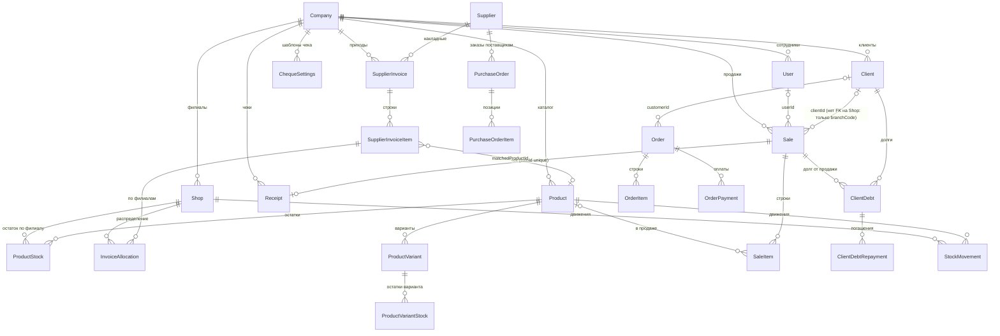

# Модель данных

**Последнее обновление:** 2026-10-16
**Источник:** `prisma/schema.prisma` (78 моделей, 21 enum), миграции `prisma/migrations/` (последняя: `20261016120000_cheque_printer_profile`).

Здесь описаны основные сущности, их ключевые поля, связи и enum'ы. Полный список полей смотрите в схеме. Если документ расходится с `schema.prisma`, верна схема.

Связанные документы: [architecture.md](./architecture.md), [api.md](./api.md), [attribute-dictionaries.md](./attribute-dictionaries.md).

---

## 1. Общие соглашения

- **Мультиарендность.** Почти все таблицы содержат `companyId`. Запросы сервисов всегда фильтруются по нему (см. [architecture.md](./architecture.md#4-мультиарендность-и-авторизация)).
- **Филиал.** `Shop` идентифицируется `id` (uuid) и `branchCode`. Пара `(companyId, branchCode)` уникальна. В `ProductStock` и `ProductVariantStock` есть и `shopId`, и `branchCode`, оба уникальны в паре с товаром. В `Sale` есть только `branchCode`.
- **Идентификаторы.** Смешанные: `Int autoincrement` (`User`, `Product`, `Supplier`, `Sale`, `Category`, `Brand`, `ProductStock`), `uuid` (`Company`, `Shop`, `Client`, `Order`, `ProductVariant`, `Receipt`, `SupplierInvoice` и большинство остальных). Таблицы `SupplierInvoice` и `PurchaseOrder` дополнительно имеют `intId`/`number` (`autoincrement`) для человекочитаемых номеров.
- **Деньги.** Везде, где используется `Decimal`, точность `(14,2)` для сумм и `(14,3)` для количества. `Float` в каталоге, остатках, чеке и части настроек. Подробности и план перехода: раздел 6.
- **Временные метки.** `createdAt` у всех таблиц. `updatedAt` (`@updatedAt`) у большинства изменяемых таблиц. Исключения и текстовые даты перечислены в таблице расхождений.
- **Удаление.** Поведение `onDelete` задано у каждой связи в `schema.prisma` (всего 153 указания). Связи от `Company` и от документов к их строкам обычно `Cascade` (например, `Receipt` удаляется вместе с `Sale`). Ссылки на клиента, сотрудника и филиал из продаж и долгов обычно `SetNull`. Перед удалением сущностей проверяйте `onDelete` в схеме.

---

## 2. Группы сущностей

### 2.1 Компания, филиалы, пользователи, доступ

| Модель | Ключевые поля | Примечание |
|---|---|---|
| `Company` | `id` uuid, `login` (unique), `name`, `subdomain` (unique), `status` String (`active`), `isActive`, `supplyPriceStrategy` (enum), `storeType` (enum), `useAttributeDictionaries`, `productFeatureSettings` Json | корень тенанта |
| `Shop` | `id` uuid, `companyId`, `name`, `branchCode`, `address`, `phoneNumbers` Json, `workingHours` Json, `isActive` | уникален `(companyId, branchCode)` |
| `User` | `id` Int, `companyId`, `phoneNumber`, `passwordHash`, `userType` (enum), `crmRoleId`, `currentShopId`, `canSwitchShops`, `status` String, `isActive`, `deletedAt` Int | уникален `(companyId, phoneNumber)` |
| `UserShopAccess` | `userId`, `shopId` | доступ пользователя к филиалам |
| `AuthSession` | `id` String, `userId`, `refreshTokenHash`, `expiresAt`, `revokedAt`, `replacedById` | сессии и ротация refresh-токенов |
| `Role` | `id` uuid, `companyId`, `name`, `externalId` Int, `isAdmin`, `type` Int, `deletedAt` Int | CRM-роль компании, права в `RolePermission` |
| `RolePermission` | `roleId`, `permissionId`, `isActive` | права роли |
| `CompanyRole` | `id` uuid, `companyId`, `code`, `name`, `isSystem`, `isActive` | роли компании по `code` (см. справочник) |
| `CompanyProfileSetting`, `CompanyTariffSetting`, `CompanyCurrencySetting`, `LoyaltyProgramSetting` | `companyId` | настройки компании (профиль в Json, валюта, лояльность) |
| `CountryReference`, `TimeZoneReference` | справочники стран и часовых поясов | глобальные |

### 2.2 Платформа (SaaS)

| Модель | Ключевые поля |
|---|---|
| `Plan` | `name`, `priceMonthly` Decimal(14,2), `maxShops`, `maxUsers`, `maxProducts`, `status` String |
| `Subscription` | `companyId`, `planId`, `status` String, `startDate`, `endDate` |
| `Payment` | `companyId`, `subscriptionId`, `amount` Decimal(14,2), `method` String, `periodStart`, `periodEnd`. Это платёж компании за подписку, не оплата покупки |
| `PlatformActionLog` | журнал действий оператора (`action`, `adminId`, `companyId`) |
| `PlatformSetting` | `id` = `'default'`, `data` Json (политика безопасности, уведомления) |

### 2.3 Каталог и атрибуты

| Модель | Ключевые поля | Примечание |
|---|---|---|
| `Product` | `id` Int, `publicId` uuid, `companyId`, `name`, `sku`, `article`, `barcode`, `purchasePrice` Float, `salePrice` Float, `discountPrice` Float, `quantity` Float, `categoryId`, `brandId`, `season` (enum), `seasonYear`, `collection`, `archivedAt`, `seasonValueId`, `collectionValueId` | уникальны `(companyId, sku)`, `(companyId, article)`, `(companyId, barcode)` |
| `ProductVariant` | `id` uuid, `productId`, `colorId`, `sizeId`, `barcode`, `sku`, `purchasePrice` Float, `salePrice` Float, `optionsKey`, `isDefault`, `isActive`, `colorValueId`, `sizeValueId` | вариант товара (цвет/размер) |
| `ProductStock` | `id` Int, `productId`, `shopId`, `branchCode`, `quantity` Float, `purchasePrice` Float, `salePrice` Float | остаток и цены по филиалу (per-filial pricing). Уникален `(productId, shopId)` и `(productId, branchCode)` |
| `ProductVariantStock` | `id` uuid, `variantId`, `shopId`, `branchCode`, `quantity` Float, `purchasePrice`, `salePrice` | остаток варианта по филиалу |
| `ProductSupplier` | `productId`, `supplierId` | связь товар-поставщик |
| `ProductColor`, `ProductSize`, `ProductSeasonOption` | legacy-справочники, `attributeValueId` | см. раздел 5 |
| `ProductSizeKind`, `ProductSizeType`, `ProductSizeSystem` | enum'ы размеров | см. раздел 4 |
| `ProductBundleComponent` | `bundleProductId`, `componentProductId`, `componentVariantId`, `quantity` Decimal(14,3) | комплекты |
| `Category`, `Brand` | `companyId`, `name` (unique в паре с `companyId`) | |
| `AttributeValue` | `id` uuid, `type` (enum), `companyId` NULL для системных значений, `code`, `name`, `group`, `archivedAt` | общий справочник цветов/размеров/сезонов, см. [attribute-dictionaries.md](./attribute-dictionaries.md) |
| `StoreAttributeSetting` | `companyId`, `attributeId`, `isHidden`, `sortOrder` | скрытие/порядок системных значений для компании |
| `AttributeDefinition`, `AttributeOption` | тенантные атрибуты товара (`kind`: SELECT/TEXT/NUMBER), опции | |
| `ProductAttributeAxis`, `VariantAttributeValue`, `ProductAttributeValue` | оси вариантов и значения атрибутов | |
| `AttributeBindingLog` | журнал `attributes:apply` / `attributes:rollback` | |
| `ProductImportSession` | `id` String, `jobId`, `shopId`, `branchCode`, `mode` String, `status` String, `fields`, `rows`, `items`, `onMatchPolicy`, `result` Json, `createdAt` **String**, `updatedAt` **String** | сессии импорта файла (см. [import.md](./import.md)) |

### 2.4 Закупки и приходы

| Модель | Ключевые поля | Примечание |
|---|---|---|
| `Supplier` | `id` Int, `companyId`, `name`, `phone`, `telegram`, `isActive` | уникален `(companyId, name)` |
| `SupplierInvoice` | `id` uuid, `intId` Int, `companyId`, `supplierId`, `invoiceNumber`, `invoiceDate`, `status` (enum), `originalFiles` Json, `totalAmount` Decimal(14,2), `totalQuantity` Decimal(14,3), `idempotencyKey`, `committedAt`, `rolledBackAt` | приход по накладной. Уникален `(companyId, idempotencyKey)` |
| `SupplierInvoiceItem` | `id` uuid, `invoiceId`, `rawName`, `correctedName`, `rawSku`, `rawBarcode`, `quantity` Decimal(14,3), `supplyPrice` Decimal(14,2), `totalPrice`, `matchedProductId`, `matchedVariantId`, `matchMethod`, `matchConfidence` Int, `status` (enum), `userConfirmed`, `warnings` Json | строка накладной |
| `InvoiceAllocation` | `invoiceItemId`, `shopId`, `quantity` Decimal(14,3) | распределение строки по филиалам. Уникален `(invoiceItemId, shopId)` |
| `SupplierProductAlias` | `companyId`, `supplierId`, `productId`, `variantId`, `supplierName`, `supplierSku`, `supplierBarcode`, `usageCount` | «псевдонимы» названий поставщика для сопоставления |
| `ProductSupplyPriceHistory` | `productId`, `variantId`, `shopId`, `supplyPrice` Decimal(14,2), `oldSupplyPrice` Decimal(14,2) | история закупочных цен |
| `PurchaseOrder` | `id` uuid, `number` Int, `companyId`, `supplierId`, `shopId`, `status` (enum), `expectedAt`, `sentAt`, `receivedAt`, `cancelledAt` | заказ поставщику |
| `PurchaseOrderItem` | `orderId`, `productId`, `variantId`, `quantity` Decimal(14,3), `receivedQuantity` Decimal(14,3), `supplyPrice` Decimal(14,2) | |

### 2.5 Продажи (POS, модель `Sale`)

| Модель | Ключевые поля | Примечание |
|---|---|---|
| `Sale` | `id` Int, `companyId`, `number` (unique), `saleType`, `status` String (`draft`), `isDraft`, `discountPercent` Decimal(14,2), `discountAmount`, `payableTotal`, `total`, `cashbackAmount`, `cashbackPaid`, `debtCredit`, `paymentMethod`, `extraPayments` Json, `clientId`, `clientName`, `branchCode`, `userId`, `parentSaleId`, `cancelledAt`, `paidAt` | основной документ продажи/возврата. Отдельного `shopId` нет |
| `SaleItem` | `id` Int, `saleId`, `productId`, `variantId`, `sellerId`, `name`, `barcode`, `sku`, `quantity` Decimal(14,3), `salePrice`, `lineTotal`, `retailPriceAtSale`, `supplyPriceAtSale`, `profitAtSale`, `markupAtSale`, `sellerBonusAmount`, `stockComposition` Json | строка продажи. Цены зафиксированы на момент продажи |
| `Receipt` | `id` uuid, `saleId` (unique), `companyId`, `shopId`, `branchCode`, `number`, `status` String (`CREATED`/`PRINTED`/`SENT`), `items` Json, `subtotal`, `discount`, `totalDue`, `paidCash`, `paidCard`, `paidCashback`, `debt`, `balance*`, `debt*`, `qrPayload`, `printedAt`, `sentAt` | чек. Поля-снимок Float. См. [receipts.md](./receipts.md) |
| `ChequeSettings` | `id` uuid, `companyId`, `name`, `isDefault`, `paperWidth`, `printableWidth`, `offsetMm`, `feedMm`, `printMode`, `fontSize`, `itemDividers`, `hasLogo`, `logoUrl`, `brandName`, `footerMessage`, `qrCodeUrl`, `elementStyles` Json, `blocks` Json | шаблон чека. Блоки: `ChequeBlockDefinition[]` |
| `Order` | `id` uuid, `companyId`, `shopId`, `cashboxId`, `userId`, `orderNumber` (unique в паре с `companyId`), `orderType`, `status`, `customerId`, `totalPrice`, `discountAmount`, `paidAmount` Decimal(14,2), `versionNumber`, `completedAt` | параллельная модель заказа для `/api/orders`. См. раздел 6 |
| `OrderItem` | `orderId`, `productId`, `variantId`, `quantity` Decimal(14,3), `price`, `discountAmount`, `totalPrice` | уникален `(orderId, productId)` |
| `OrderPayment` | `orderId`, `paymentTypeId`, `amount` Decimal(14,2) | |
| `PaymentType` | `companyId`, `name`, `isCash`, `isActive` | системный тип оплаты компании |
| `CompanyPaymentType` | `companyId`, `name`, `token`, `paymentTypeId`, `isCashPaymentType`, `dontShowInMakePayment`, `dontShowInSettings` | тип оплаты, который видит кассир. Используется в погашении долга |
| `Cashbox` | `companyId`, `shopId`, `name`, `chequeId`, `ePos`, `webKassa`, `isActive` | касса филиала |

### 2.6 Клиенты и долги

| Модель | Ключевые поля | Примечание |
|---|---|---|
| `Client` | `id` uuid, `companyId`, `code`, `firstName`, `lastName`, `phone`, `gender` (enum), `birthDate` Date, `registrationShopId`, `marketingAllowed`, `balanceUzs`, `debtUzs`, `totalPurchasesUzs` Decimal(14,2), `visitsCount`, уведомления (`smsNotifications` и др.) | уникален `(companyId, code)`. Баланс и долг хранятся денормализованно |
| `ClientGroup`, `ClientGroupLink`, `ClientTag`, `ClientTagLink`, `ClientNote` | группы, теги, заметки | |
| `ClientCard` | `companyId`, `clientId`, `type` (enum), `number` (unique в паре с `companyId`), `isActive`, `expiresAt` | карта клиента |
| `ClientDebt` | `id` uuid, `companyId`, `clientId`, `saleId`, `shopId`, `amountUzs`, `remainingAmountUzs`, `repaidAmountUzs`, `dueDate`, `status` (enum), `comment`, `receiptUrl` | долг. Decimal(14,2) |
| `ClientDebtRepayment` | `id` uuid, `debtId`, `clientId`, `amountUzs` Decimal(14,2), `idempotencyKey`, `paymentMethod` (id `CompanyPaymentType`), `paymentMethodName`, `branchCode` | погашение. Уникален `(companyId, debtId, idempotencyKey)` |

### 2.7 Склад, инвентаризация, трансферы

| Модель | Ключевые поля | Примечание |
|---|---|---|
| `StockMovement` | `id` uuid, `companyId`, `shopId`, `productId`, `variantId`, `orderId`, `type` (enum), `quantity` Decimal(14,3), `beforeQuantity`, `afterQuantity`, `supplyPrice`, `retailPrice`, `externalId`, `referenceType`, `referenceId`, `createdById` | журнал движений. Откат прихода ищет движения по `type = PURCHASE` и `externalId` |
| `InventorySession` | `id` uuid, `companyId`, `shopId`, `number` (unique в паре с `companyId`), `status` String (`DRAFT`), `countMode`, `lockStockOperations`, `version` | инвентаризация. Статусы — String |
| `InventoryItem` | `inventorySessionId`, `productId`, `variantId`, `systemQuantitySnapshot` Float, `countedQuantity` Float, `costPriceSnapshot` Float, `status` String | строка инвентаризации |
| `InventoryCountAttempt` | `inventoryItemId`, `attemptNumber`, `countedQuantity` Float | попытки пересчёта |
| `Transfer` | `id` uuid, `externalId` Int (unique), `departureShopId`, `arrivalShopId`, `status` (enum), `useDepartureShopPrices` | перемещение между филиалами |
| `TransferItem` | `transferId`, `productId`, `variantId`, `quantity` Decimal(14,3), `arrivedQuantity` Decimal(14,3) | |

### 2.8 Прочее

| Модель | Назначение |
|---|---|
| `SellerSalarySettings` | настройки зарплаты продавца (`calculationType` enum, `fixedSalary` Float, `salaryPercent` Float) |
| `AuditLog` | журнал действий (`action`, `entity`, `entityId`, `meta` Json) |
| `TelegramSubscriber`, `TelegramLinkToken` | подписчики бота и одноразовые токены привязки |
| `PriceTagSetting` | шаблоны ценников (`width`, `length` Float, `barcodeType`, `properties` Json) |
| `LoyaltyProgramSetting`, `MeasurementUnitSetting` | лояльность и единицы измерения компании |

---

## 3. Связи (ER-диаграмма основных сущностей)

Диаграмма показывает основные сущности из задания. Не все поля указаны.

Ключевые правила связей:

- `Receipt.saleId` уникален: один чек на одну продажу.
- `ClientDebt.saleId` ссылается на `Sale`, при удалении продажи `SetNull`.
- `SupplierInvoiceItem.matchedProductId` устанавливается только после подтверждения пользователем (`userConfirmed`).
- `ProductStock` уникален по `(productId, shopId)` и `(productId, branchCode)`.

---

## 4. Enum'ы (все 21)

Значения приведены так, как записаны в `schema.prisma`. Регистр важен: в API и в БД значения сравниваются точно.

| Enum | Значения | Регистр |
|---|---|---|
| `UserType` | `platform`, `company` | lower |
| `OrderStatus` | `DRAFT`, `COMPLETED`, `CANCELLED`, `PARKED`, `RETURNED` | UPPER |
| `OrderType` | `SALE`, `RETURN` | UPPER |
| `StockMovementType` | `SALE`, `RETURN`, `WRITE_OFF`, `PURCHASE`, `TRANSFER`, `ADJUSTMENT`, `INVENTORY_ADJUSTMENT` | UPPER |
| `TransferStatus` | `DRAFT`, `SENT`, `ACCEPTED`, `CANCELLED` | UPPER |
| `SalaryCalculationType` | `FIXED_ONLY`, `PROFIT_PERCENT_ONLY`, `REVENUE_PERCENT_ONLY`, `FIXED_PLUS_PROFIT`, `FIXED_PLUS_REVENUE` | UPPER |
| `ClientGender` | `male`, `female`, `unknown` | lower |
| `ClientDebtStatus` | `paid`, `partial`, `unpaid` | lower |
| `ClientCardType` | `local`, `loyalty`, `discount`, `bonus` | lower |
| `ProductTier` | `BUDGET`, `MID`, `PREMIUM` | UPPER |
| `PurchaseOrderStatus` | `DRAFT`, `SENT`, `PARTIAL`, `RECEIVED`, `CANCELLED` | UPPER |
| `SupplierInvoiceStatus` | `DRAFT`, `PROCESSING`, `REVIEW`, `READY`, `COMMITTED`, `CANCELLED`, `ROLLED_BACK` | UPPER |
| `SupplierInvoiceItemStatus` | `MATCHED`, `NEEDS_REVIEW`, `NEW_PRODUCT`, `ERROR` | UPPER |
| `SupplyPriceStrategy` | `LAST_PURCHASE`, `WEIGHTED_AVERAGE`, `MANUAL` | UPPER |
| `ProductSeason` | `SS`, `AW`, `NO_SEASON` | UPPER |
| `ProductSizeType` | `CLOTHING`, `SHOES`, `OTHER` | UPPER |
| `ProductSizeSystem` | `EU`, `US`, `UK`, `OTHER` | UPPER |
| `ProductSizeKind` | `CLOTHING`, `SHOES` | UPPER |
| `StoreType` | `ACCESSORIES`, `CLOTHING`, `SHOES`, `CLOTHING_SHOES` | UPPER |
| `AttributeValueType` | `COLOR`, `SIZE`, `SEASON` | UPPER |
| `AttributeKind` | `SELECT`, `TEXT`, `NUMBER` | UPPER |

Поля, которые **должны** быть enum, но хранятся как `String` (план миграции, раздел 6): `Company.status`, `User.status`, `Sale.status`, `Sale.saleType`, `Receipt.status`, `InventorySession.status`/`type`/`countMode`, `InventoryItem.status`, `ProductImportSession.status`/`mode`, `Plan.status`, `Subscription.status`, `Payment.method`, `ChequeSettings.printMode`/`dividerStyle`, `Client.maritalStatus` (свободный текст), `Company.businessType`.

---

## 5. Единый справочник атрибутов

Ниже канонические термины, которыми следует называть одно и то же понятие в документации, UI и новом коде. Колонка «Алиасы в коде» перечисляет существующие имена. **Канон является предложением** и вступает в силу после согласования с владельцем продукта. Миграция полей не выполнена (см. раздел 6).

| Понятие (русский) | Канонический термин | Где используется сейчас | Алиасы в коде | Примечание |
|---|---|---|---|---|
| Закупочная цена (текущая, в карточке) | `purchasePrice` | `Product`, `ProductVariant`, `ProductStock`, `ProductVariantStock` | `supplyPrice` (в накладных и заказах), `costPriceSnapshot` (`InventoryItem`) | Для остатков по филиалам — `ProductStock.purchasePrice` |
| Цена поставки в строке документа | `supplyPrice` | `SupplierInvoiceItem`, `PurchaseOrderItem`, `StockMovement`, `ProductSupplyPriceHistory` | `purchasePrice` (в `Product`) | Строка документа — всегда `supplyPrice` |
| Себестоимость на момент продажи | `supplyPriceAtSale` | `SaleItem` | `costPriceSnapshot` (инвентаризация) | |
| Розничная цена (текущая) | `salePrice` | `Product`, `ProductVariant`, `ProductStock`, `ProductVariantStock` | `retailPrice` (`StockMovement`), `price` (`OrderItem`), `retailPriceAtSale` (`SaleItem`) | `discountPrice` — отдельная цена со скидкой, не синоним |
| Розничная цена в строке продажи | `salePrice` (в `SaleItem`) | `SaleItem.salePrice`, `OrderItem.price` | `retailPriceAtSale` | Выбрать одно имя при миграции |
| Покупатель | `Client` / `clientId` | `Sale.clientId`, `ClientDebt.clientId`, `Client` | `customerId` (в `Order`, `Receipt` через связь) | Для `Order` используется `customerId` |
| Филиал | `Shop` (`shopId`) + `branchCode` | `ProductStock`, `Order`, `ClientDebt` (`shopId`); `Sale`, `Receipt`, `ClientDebtRepayment` (`branchCode`) | `branchCode` в UI — никогда не показывать | Отображать `Shop.name` |
| Телефон | `phone` (клиент, поставщик), `phoneNumber` (пользователь) | `Client.phone`, `Supplier.phone`, `User.phoneNumber` | `ownerPhone` (`Company`), `phoneNumbers` (`Shop`, Json), `managerPhone`/`clientPhone` (`Receipt`); в API `phone_number` | См. таблицу расхождений |
| Скидка в процентах | `discountPercent` | `Sale` (Decimal), `Receipt` (Float) | | Тип разный |
| Сумма в сумах для клиентских денег | `…Uzs` (`balanceUzs`, `debtUzs`, `amountUzs`) | `Client`, `ClientDebt`, `ClientDebtRepayment` | `amount`, `total`, `paidAmount` в других моделях | Суффикс только в клиентском блоке |
| Продажа (документ кассы) | `Sale` | `Sale`, `SaleItem`, `/api/new-sale`, `/api/order` | `Order` (параллельная модель) | Документ, который печатается в чеке |
| Заказ (параллельная модель) | `Order` | `Order`, `OrderItem`, `OrderPayment`, `/api/orders` | | Статус завершения см. таблицу расхождений |
| Чек (документ печати) | `Receipt` (по продаже), `ChequeSettings` (шаблон) | `Receipt`, `ChequeSettings`, `/api/receipts`, `/api/cheque` | «чек» в UI = `Receipt` | |
| Приход (документ поставщика) | `SupplierInvoice` | `SupplierInvoice*`, `/api/supplier-invoices`, `/api/v2/imports` | «приход» в UI; `ProductImportSession` для импорта файла | Два пути поступления, см. [import.md](./import.md) |
| Роль в CRM | `Role` (через `User.crmRoleId`) | `Role`, `RolePermission`, `/api/v2/role` | `CompanyRole` (справочник по `code`) | Уточнить назначение `CompanyRole` |
| Пол клиента | `ClientGender` | `Client.gender` | | Значения в lower case |
| Статус долга | `ClientDebtStatus` | `ClientDebt.status` | | Значения в lower case |
| Тип карты | `ClientCardType` | `ClientCard.type` | | Значения в lower case |
| Атрибут цвета/размера/сезона | `AttributeValue` (общий), legacy `ProductColor`/`ProductSize`/`ProductSeasonOption` | см. [attribute-dictionaries.md](./attribute-dictionaries.md) | | Legacy связан через `attributeValueId` |
| Тип клиентского блока чека | `ChequeBlockDefinition` (`key`, `block_type`, `name`, `sequence_number`, `is_active`) | `ChequeSettings.blocks` | | Ключи в `cheque-blocks.constant.ts` |

---

## 6. Таблица расхождений

Таблица составлена по `docs/audit-report.md` (аудит 2026-10-07) и проверена по `schema.prisma`. Одно исходное утверждение аудита исправлено: `ProductSupplyPriceHistory.supplyPrice` имеет тип `Decimal(14,2)`, а не `(14,2)`.

| # | Тема | Факт в схеме | Риск | Рекомендация |
|---|---|---|---|---|
| 1 | Тип денег | Все `Decimal` теперь `(14,2)` / `(14,3)` (миграция `20261016140000_widen_decimals_add_updated_at`). Остаётся `Float`: `Product`, `ProductVariant`, `ProductVariantStock`, `ProductStock`, `InventoryItem`, `Receipt`, `SellerSalarySettings` | Ошибки округления, расхождение сумм между чеком и накладной | Перейти на `Decimal` по таблицам (раздел 6.1) |
| 2 | Одинаковые понятия, разные имена | `purchasePrice` / `supplyPrice` / `costPriceSnapshot`; `salePrice` / `retailPrice` / `price` | Ошибки в отчётах, путаница в коде | Канонические термины из раздела 5 |
| 3 | Клиент в продаже и заказе | `Sale.clientId` и `Order.customerId` | Двойная логика привязки клиента | Выбрать одно имя |
| 4 | Филиал | `Sale` имеет только `branchCode`; `Order` имеет `shopId`; `ProductStock` имеет оба | Риск рассинхронизации | Добавить `shopId` при миграции (пока не делается) |
| 5 | Телефон | `Client.phone`, `User.phoneNumber`, `Company.ownerPhone`, `Shop.phoneNumbers` (Json), `Receipt.managerPhone`; API: `phone_number`, `owner_phone` | Неверный поиск по номеру, разный формат | Единая нормализация (см. раздел 6.4) |
| 6 | `discountPercent` | `Sale`: Decimal(14,2); `Receipt`: Float | Расхождение в чеке и продаже | Decimal |
| 7 | Суффикс `Uzs` | только `Client`, `ClientDebt`, `ClientDebtRepayment` | Непоследовательность | Суффикс или единый формат при миграции |
| 8 | Роли | `Role` (CRM-роли, права) и `CompanyRole` (`code`, `isSystem`) | Непонятно, какая модель источник | Уточнить назначение `CompanyRole` |
| 9 | Два заказа | `Sale` (Int id, `/new-sale`) и `Order` (uuid id, `/orders`) | Два пути продажи, разные отчёты | Консолидация (план, раздел 6.6) |
| 10 | Регистр enum | lower: `UserType`, `ClientGender`, `ClientDebtStatus`, `ClientCardType`. UPPER: остальные | Ошибки сравнения строк | Привести к одному регистру при миграции на enum |
| 11 | Статусы как String | `Sale.status`, `Receipt.status`, `InventorySession.status`, `Company.status`, `User.status`, `ProductImportSession.status` и др. | Нет проверки значений в БД | Перевести на enum (раздел 6.3) |
| 12 | Удаление | `User.deletedAt` и `Role.deletedAt` — `Int` (0 = не удалён) | Не типизированная дата | `DateTime?` |
| 13 | `updatedAt` | нет у `TelegramSubscriber`, `TelegramLinkToken`, `OrderPayment`, `ClientDebtRepayment`, `Payment`, `ProductSupplier`, `ClientGroupLink`, `ClientTagLink`, `StockMovement`, `ProductSupplyPriceHistory`, `AuditLog`, `InventoryCountAttempt`. Проверить, какие из них изменяются | Невозможно понять время последнего изменения | Выполнено для четырёх изменяемых таблиц (`TelegramSubscriber`, `TelegramLinkToken`, `ProductSupplier`, `InventoryCountAttempt`); остальные таблицы в коде не обновляются (append-only), поле им не нужно |
| 14 | Даты в строках | `ProductImportSession.createdAt` / `updatedAt` — `String` | Сортировка и фильтры по строке | `DateTime` |
| 15 | Тип id | `User`, `Product`, `Sale`, `Supplier`, `Category`, `Brand` — Int; остальные uuid | Разные формы в API, сложнее интеграции | Менять только если продукт решит |
| 16 | API-ключи | snake_case (`phone_number`, `status_code`, `on_match`, `amount_uzs`, `branch_location`) и camelCase (DTO `orders`, `supplier-invoices`, `purchase-orders`) | Клиенту нужно знать два стиля | Дуальное принятие ключей, затем переход (раздел 6.2) |

### 6.1 Деньги во Float и Decimal (план)

1. Таблица за таблицей: добавить `Decimal`-колонку, заполнить, сверить суммы (reconciliation), переключить чтение, удалить Float-колонку.
2. ~~Расширить `Decimal(14,x)` до `Decimal(14,x)`~~ — выполнено (48 колонок), откат: `down.sql` рядом с миграцией.
3. Для остатков добавить проверку `quantity >= 0` (см. `docs/sql/check-negative-stock.sql`, сначала очистить данные).

### 6.2 API-ключи и DTO

Ввести типизированные DTO с дуальным приёмом ключей (`snake_case` и `camelCase`), затем перевести фронтенд, затем удалить старый ключ.

### 6.3 Статусы в enum

Порядок: `Sale.status`, `Receipt.status`, `InventorySession.status`, `ProductImportSession.status`, затем `Company`, `User`, `Plan`, `Subscription`. Перед миграцией собрать все значения из БД.

### 6.4 Телефоны

Сейчас `UsersService.normalizePhoneNumber` и `prisma/seed.ts` оставляют только цифры. `LoginDto` при этом принимает номер с необязательным `+`, а при входе `UsersService.findByPhoneNumberAndCompany` ищет по набору вариантов (`buildPhoneNumberLookupVariants`). Нужна одна функция нормализации, миграция существующих значений и индекс по нормализованному номеру.

### 6.5 Прочие изменения

- `deletedAt Int` → `DateTime?` (`User`, `Role`).
- `updatedAt` для изменяемых таблиц (таблица 13).
- Тип id для `Order`/`Sale`: только по решению продукта.

### 6.6 Консолидация `Order` и `Sale`

Не начинать без отдельного согласования. Сначала определить, какой путь основной, затем перенести отчёты и API. Текущее состояние: `OrdersService.complete` не подключён к контроллеру (нет маршрута завершения заказа).

### 6.7 Рекомендуемый порядок

1. Общие типы на фронтенде (уже сделаны: `types/enums.ts`, `types/common.ts`).
2. Типизированные DTO с дуальным приёмом ключей.
3. ~~Расширение точности и добавление nullable `updatedAt`~~ — выполнено 2026-10-16 (проверено на копии: применение, откат, повторное применение, нулевой drift).
4. Enum для статусов.
5. Float → Decimal по таблицам с reconciliation.
6. Изменение id только по решению продукта.

Из этого раздела выполнен только шаг 3 (и шаг 1). Остальные изменения **не выполнены** на 2026-10-16.
